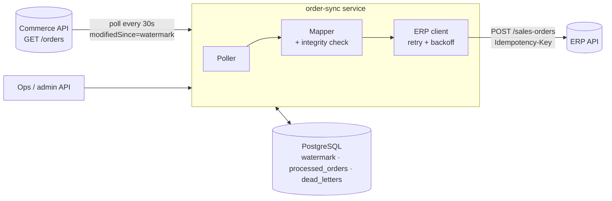

# commerce-order-sync

[](https://github.com/digitalserv01/commerce-order-sync/actions/workflows/ci.yml)

**A Spring Boot service that moves orders from an e-commerce platform into an ERP without losing them, without duplicating them, and without one bad order blocking the rest.**

Every store that runs a separate ERP needs a version of this: an order is placed online, and finance and logistics need it in the ERP. The naive version (a cron job that POSTs new orders) breaks in production:

| What goes wrong in production | What this service does |
|---|---|
| The ERP is down for 2 minutes and orders are lost | Retries with exponential backoff, then parks the order in a dead-letter table you can replay |
| The job crashes halfway and re-sends everything, so the ERP gets duplicate orders | Each order version is recorded once synced, and every ERP call carries an `Idempotency-Key` |
| One malformed order throws and blocks the whole queue | Invalid orders are dead-lettered with the reason, and the run continues |
| Totals in the ERP don't match what the customer paid | The mapper recomputes totals from the lines and refuses inconsistent orders |
| The commerce API times out on page 7 of 10 | Progress is committed page by page, so the next run resumes without gaps |

## Architecture



**One run:**
1. Read the watermark (the `modifiedAt` of the last order handled).
2. `GET /orders?modifiedSince=<watermark>&page=N`. Every page in a run uses the same watermark, so pages don't shift under the reader.
3. For each order:
   - Already in `processed_orders` (same code and version)? **Skip.**
   - Map it to an ERP sales order. Invalid data goes to the **dead-letter** table (`MAPPING`).
   - `POST` it to the ERP:
     - `201`: record it as processed.
     - `409`: the ERP already has it under this idempotency key. Record it as processed.
     - `4xx`: **dead-letter** it (`ERP_REJECTED`), without retrying. The same payload would be refused again.
     - `5xx` or timeout: **retry** with backoff (1s, 2s, 4s…). If it's still failing, **dead-letter** it (`ERP_UNAVAILABLE`).
4. After each page, move the watermark forward and commit.

## Run it in 60 seconds

Requires Docker.

```bash
docker compose up --build
```

This starts the service, PostgreSQL and two fake APIs ([WireMock](https://wiremock.org)) loaded with 3 demo orders:

| Order | What happens |
|---|---|
| `ORD-1001` | Synced to the ERP |
| `ORD-1002` | Its total doesn't match its lines, so it's dead-lettered as `MAPPING` and never sent |
| `ORD-1003` | The ERP refuses the customer (credit hold, 422), so it's dead-lettered as `ERP_REJECTED` |

The first run happens on startup. Then:

```bash
# status: watermark, synced count, dead-letter count
curl -s -H "X-Admin-Key: demo-admin-key" localhost:8080/admin/status

# what failed and why
curl -s -H "X-Admin-Key: demo-admin-key" localhost:8080/admin/dead-letters

# trigger a run now instead of waiting for the next tick (orders already synced are skipped)
curl -s -X POST -H "X-Admin-Key: demo-admin-key" localhost:8080/admin/sync

# after fixing the cause, re-send a dead-lettered order (id from the list above)
curl -s -X POST -H "X-Admin-Key: demo-admin-key" localhost:8080/admin/dead-letters/1/replay

# metrics: orders.processed{outcome=synced|skipped|dead_lettered}
curl -s localhost:8080/actuator/metrics/orders.processed
```

## Admin API

All `/admin/**` calls require the `X-Admin-Key` header.

| Method | Path | Purpose |
|---|---|---|
| `GET` | `/admin/status` | Watermark, processed count, dead-letter count |
| `POST` | `/admin/sync` | Run a sync now (`409` if one is already running) |
| `GET` | `/admin/dead-letters` | Failed orders, with failure type and error message |
| `POST` | `/admin/dead-letters/{id}/replay` | Re-send one. If it fails again, a fresh dead letter replaces the old one |
| `GET` | `/actuator/health`, `/actuator/metrics` | Health and Micrometer metrics |

## Configuration

All configuration comes from the environment. There are **no defaults in code**: a missing endpoint or key fails at startup rather than syncing against the wrong system.

| Variable | Example |
|---|---|
| `DB_URL`, `DB_USER`, `DB_PASSWORD` | `jdbc:postgresql://db:5432/ordersync` |
| `COMMERCE_BASE_URL`, `COMMERCE_API_KEY` | `https://shop.example.com/api` |
| `ERP_BASE_URL`, `ERP_API_KEY` | `https://erp.example.com/api` |
| `ADMIN_API_KEY` | any long random string |
| `SYNC_INITIAL_WATERMARK` | `2026-01-01T00:00:00Z` (where the very first run starts) |

The polling interval, page size, HTTP timeout and retry policy are in [`application.yml`](src/main/resources/application.yml).

## Adapting it to a real platform

The sync logic only depends on two small clients, so pointing it at a real system means rewriting one class each:

- **Commerce side** ([`CommerceClient`](src/main/java/dev/ordersync/commerce/CommerceClient.java)): *Shopify* (Admin API `orders.json?updated_at_min=`), *Commercetools* (`/orders?where=lastModifiedAt >= …`), *SAP Commerce Cloud* (OCC order endpoints), *WooCommerce* (`/orders?modified_after=`), or any REST API that can filter by modification date.
- **ERP side** ([`ErpClient`](src/main/java/dev/ordersync/erp/ErpClient.java)): Odoo, Dynamics 365 Business Central, NetSuite, SAP S/4HANA (OData), or an in-house API. If the ERP has no idempotency support, the `processed_orders` table still prevents duplicates outside the crash window.
- **Mapping** ([`OrderMapper`](src/main/java/dev/ordersync/mapping/OrderMapper.java)): a pure function with its own unit tests. This is where client-specific rules go (tax, discounts, warehouses).

## Tests

```bash
mvn verify      # 27 tests, no Docker needed
```

- **Mapper unit tests:** totals, rounding, optional fields, and every rejection rule.
- **Sync integration tests** (fake commerce + ERP servers, in-memory DB): happy path, duplicate polling, new order versions, ERP `409`, `503 → 503 → 201` retry, `400` rejection, ERP down after all retries, invalid data, a commerce outage, pagination, and a failure mid-pagination.
- **Admin API tests:** auth, manual run, status, dead-letter listing, replay (success and failing again), metrics.

## Design notes and limits

- **Single instance.** Runs never overlap inside one process. Running several replicas would need a database lock, such as `SELECT … FOR UPDATE` on `sync_state` or ShedLock.
- **Inclusive watermark.** `modifiedSince` is inclusive, so orders sharing the last timestamp are fetched again and skipped by the idempotency check instead of being missed.
- **Polling, not webhooks.** Polling is the robust baseline: it works with every platform and recovers by itself after downtime. Webhooks can be added on top to cut latency, with polling kept as the safety net.

## Stack

Java 21 · Spring Boot 3.3 · Spring Data JPA · Flyway · PostgreSQL · Spring Retry · Micrometer · JUnit 5 · WireMock · Docker Compose · GitHub Actions
